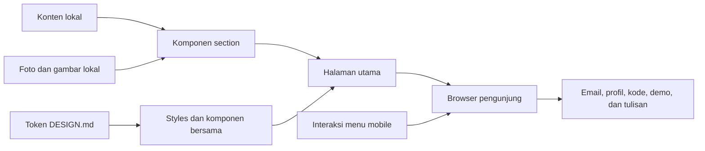

# Layout dan Arsitektur — Personal Portfolio

Status: preview lokal dengan konten CV, proyek terkurasi, dan aset asli; belum dipublikasikan.
Tanggal: 11 Oktober 2026.

Dokumen ini mengatur susunan halaman, navigasi, konten, dan pembagian tanggung jawab
teknis. Token serta aturan visual mengikuti [DESIGN.md](../DESIGN.md).

## 1. Kondisi awal dan keputusan

Folder proyek saat dokumen dibuat berisi `AGENTS.md` dan folder `docs/`, tanpa
aplikasi, `package.json`, dependensi, atau repositori Git.

Preview lokal kini sudah menggunakan Next.js, React, TypeScript, dan Tailwind CSS.
Konten CV pemilik kini mengisi profil, pengalaman, organisasi, penghargaan, dan
sertifikasi dalam ID/EN. Empat belas proyek terkurasi dari GitHub dan CV memakai aset
asli serta alur arsitektur. Speakers menampilkan tiga sesi beserta sertifikat lokal.
Papers memuat delapan makalah riset yang telah dibaca, diurutkan dari tahun terbaru; Moments menampilkan
delapan gambar dokumentasi asli. Writings belum mempunyai materi terverifikasi dan tidak dirender.
Repositori Git lokal terhubung ke [Maull09/Maull09.github.io](https://github.com/Maull09/Maull09.github.io)
melalui HTTPS. Default branch adalah `main`; deployment belum diaktifkan.

Pengalaman profesional menampilkan 28 butir dari dua versi CV; enam peran organisasi
dan kepanitiaan menampilkan delapan butir kontribusi,
dan Technical Skills memuat delapan kategori teknis dari CV serta proyek terkurasi. Detail proyek dan paper terlihat penuh.

Pada awal perencanaan, `AGENTS.md` memuat konteks produk lain. Konteks tersebut
kini sudah diganti dengan portofolio AI engineer sesuai brief yang disepakati.
Aturan umum tetap berlaku; `DESIGN.md` dan dokumen ini menjadi acuan desain
serta arsitektur portofolio.

| Status | Keputusan |
| --- | --- |
| Disepakati | Tujuan utama adalah personal branding sebagai AI engineer |
| Disepakati | Visual clean, sederhana, editorial, technical, dan monochrome; tema terang/gelap |
| Disepakati | Tiga belas section direncanakan, termasuk Technical Skills, Speakers, Papers, dan Moments |
| Dipakai pada preview | Halaman utama satu halaman dengan navigasi anchor |
| Dipakai pada preview | Next.js App Router, React, TypeScript, dan Tailwind CSS |
| Dipakai pada preview | Data lokal yang diedit di folder proyek; belum memerlukan CMS |
| Dipakai pada preview | Indonesia (`/id`) dan Inggris (`/en`), dengan pemilih bahasa |
| Dipakai pada preview | Tema mengikuti perangkat pada awal kunjungan; pilihan manual tersimpan lokal |
| Dipakai pada preview | CV asli berbentuk PDF dan tautan Email, GitHub, serta LinkedIn |
| Dipakai pada preview | Identitas Mohamad Maulana Firdaus Ramadhan; Voice AI, agentic RAG, dan sistem ML |
| Disepakati | Hosting GitHub Pages melalui static export dan GitHub Actions |
| Belum ditentukan | Tulisan tambahan dan domain final; kandidat terbaru maulanafirdaus.app dari Name.com |
| Opsional | Halaman detail proyek dan artikel lokal jika kontennya siap |

Versi dependensi mengikuti `package.json` dan `package-lock.json`. Setup GitHub
Pages dijelaskan di [GITHUB_PAGES.md](GITHUB_PAGES.md); route detail tetap opsional.

## 2. Ruang lingkup awal

Halaman utama memperkenalkan pemilik, menampilkan bukti karya dan perjalanan,
serta mengarahkan pengunjung ke tulisan dan kanal kontak.

Konten dapat dibaca tanpa akun. Versi awal memakai email dan tautan sosial sebagai
kontak, serta konten dan gambar lokal. CMS, database, autentikasi, formulir kontak,
filter proyek, chatbot AI, dan layanan freelance belum masuk ruang lingkup.
Fitur tambahan dievaluasi saat ada kebutuhan konkret.

## 3. Susunan halaman

| Urutan | Section | Anchor | Informasi utama |
| --- | --- | --- | --- |
| 1 | Hero | `#home` | Nama, AI Engineer, fokus, foto, tombol ke Projects dan CV |
| 2 | About | `#about` | Cerita, ketertarikan, nilai, dan arah eksplorasi |
| 3 | Technical Skills | `#skills` | Delapan kategori teknologi dari CV dan proyek terkurasi |
| 4 | Selected Projects | `#projects` | Satu daftar proyek berdasarkan update repository terbaru, detail lengkap |
| 5 | Experience | `#experience` | Peran, lokasi, periode, seluruh butir kontribusi CV |
| 6 | Organizations & Committees | `#organizational` | Peran organisasi dan kepanitiaan, kolaborasi, seluruh butir CV |
| 7 | Speakers | `#speakers` | Judul sesi, acara, tahun, uraian, sertifikat |
| 8 | Papers | `#papers` | Judul asli, penulis, tahun, ringkasan, evaluasi, tautan dokumen |
| 9 | Writings | `#writings` | Tulisan, eksperimen, dan pembelajaran |
| 10 | Awards | `#awards` | Penghargaan, uraian, dan bukti pencapaian |
| 11 | Certifications | `#certifications` | Kredensial, uraian kompetensi, dan tautan verifikasi |
| 12 | Moments | `#moments` | Foto lomba dan kegiatan dengan konteks |
| 13 | Contact | `#contact` | Email dan profil profesional |

Header menampilkan About, Skills, Projects, Experience, Speakers, Papers, dan Contact.
Navigasi desktop mulai 1024 px; tablet memakai disclosure menu yang sama dengan mobile. Nama ringkas pemilik
mengarah ke `#home`; Hero, About, dan metadata memakai nama lengkap.
Tombol tema selalu tersedia di header. Writings masuk
navigasi setelah tulisan tersedia. Section lain ditemukan melalui urutan halaman.
Label diterjemahkan sesuai bahasa aktif. Pemilih ID/EN berada di header desktop
dan di dalam menu mobile.

Semua section direncanakan dalam struktur. Section yang belum memiliki konten nyata
tidak dipublikasikan sebagai blok kosong; kontennya disiapkan sebelum ditampilkan.

Tahap eksplorasi sebelumnya menampilkan sepuluh section dengan Lorem ipsum dan
blok gambar netral atas permintaan pemilik. Setelah CV diberikan, entri sementara
diganti dengan sumber asli. Writings tetap kosong dan mengembalikan null.
Moments kini memakai delapan gambar dokumentasi dari folder lokal pemilik, dengan
caption serta alt text ID/EN. Rasio gambar dipertahankan dan tahun yang belum
terverifikasi tidak ditampilkan. Grid dua kolom pada desktop mengikuti urutan DOM
dari kiri ke kanan lalu baris berikutnya; mobile memakai satu kolom. Foto ditampilkan
utuh di dalam bingkai 4:3. Foto dan caption tetap menyatu. Tahun berada di sisi kiri caption. Jangan memakai banner proyek
sebagai foto kegiatan.

## 4. Wireframe desktop

```text
Header: Nama   About Skills Projects Experience Speakers Papers Contact   ID EN Tema

Hero
+-------------------------------------+---------------------------+
| Nama lengkap, Lora                   | Foto personal 208 px      |
| AI Engineer, deskripsi fokus         |                           |
| Lihat proyek / Unduh CV              |                           |
+-------------------------------------+---------------------------+

About
Cerita dengan lebar penuh container

Technical Skills
Kategori          Teknologi sesuai CV

Selected Projects
Judul, deskripsi, kontribusi, hasil, teknologi, tautan   Gambar proyek 420 px
Proyek disusun satu per baris; kolom teks rata kiri, gambar di kanan mulai 1024 px

Experience / Organizational Experience
Periode          Peran dan organisasi
                 Lokasi dan seluruh bullet points CV

Speakers
Tahun            Judul sesi, acara, topik, dan sertifikat

Papers
Tahun            Judul, penulis, jenis dokumen, ringkasan, evaluasi, PDF

Writings
Judul tulisan
Ringkasan, tanggal, dan platform

Awards / Certifications
Nama pencapaian                  Penyelenggara dan tahun

Moments
+-------------------------------+-------------------------------+
| Foto dan caption              | Foto dan caption              |
+-------------------------------+-------------------------------+

Contact: Ajakan terhubung, email, dan profil profesional
Footer: Nama dan hak cipta
```

Diagram memperlihatkan susunan dan proporsi, bukan dimensi final. Experience dan
Organizational Experience tetap dua section, begitu juga Awards dan Certifications.
Jumlah kolom galeri menyesuaikan aset serta lebar layar.

## 5. Layout mobile dan perilaku navigasi

```text
Nama                        [Menu]
Nama besar
AI Engineer
Deskripsi fokus
[Lihat proyek] [Unduh CV]
Foto personal

About
Technical Skills
Proyek berdasarkan update repository terbaru, satu per baris
Experience
Organizational Experience
Speakers
Papers
Writings
Awards
Certifications
Moments, satu foto per baris
Contact
Footer
```

- Pertahankan urutan DOM sesuai urutan baca; CSS mengatur kolom desktop.
- Header sticky dan offset anchor menjaga judul tujuan tetap terlihat.
- Menu mobile memakai disclosure native `details`/`summary`, dapat ditutup dengan Escape,
  dan kembali tertutup setelah tautan dipilih.
- Menu menempatkan tautan di alur halaman; tidak memerlukan modal atau focus trap.
- Disclosure native dan tautan anchor tetap bisa digunakan tanpa JavaScript.
- Tombol Hero menuju Projects. Tautan di entri menuju tujuan yang disebutkan.
- Gambar Moments beserta caption langsung terlihat; lightbox belum diperlukan.
- Gambar proyek memakai lebar 420 px di kanan mulai desktop 1024 px. Pada mobile
  dan tablet, gambar mengikuti teks dengan lebar hingga 640 px agar screenshot
  terbaca tanpa mempersempit teks. Logo tampil 144 px di tengah permukaan gambar.
- Detail proyek, paper, dan butir CV langsung terlihat tanpa JavaScript atau
  tindakan membuka. Gambar proyek berada setelah teks dalam DOM dan di kanan
  pada desktop agar kolom teks seluruh proyek rata kiri.

## 6. Struktur konten

Simpan data terstruktur terpisah dari komponen tampilan. Setiap daftar memiliki
identitas stabil dan urutan kurasi yang eksplisit.

| Kelompok | Data yang perlu disiapkan |
| --- | --- |
| Profile | Nama, peran, fokus, bio, foto, alt text, file CV, email, GitHub, LinkedIn |
| Technical Skills | ID kategori, nama kategori ID/EN, daftar teknologi bersama |
| Projects | ID, judul, tahun opsional, lastCommit (date ISO dan URL) atau null, ringkasan, masalah, peran, pendekatan, hasil, teknologi, gambar, tautan |
| Experience | ID, peran, organisasi, periode, lokasi ID/EN, array contributions ID/EN |
| Organizational | ID, peran, organisasi, periode, lokasi ID/EN, array contributions ID/EN |
| Speakers | ID, judul sesi, acara, tahun sesi, date ISO opsional, ringkasan ID/EN, sertifikat opsional |
| Papers | ID, judul asli, penulis, tahun, jenis dokumen, ringkasan dan evaluasi ID/EN, URL, codeLinks opsional |
| Writings | ID, judul, ringkasan, tanggal, URL, platform |
| Awards | ID, nama, penyelenggara, tahun, description ID/EN, URL bukti |
| Certifications | ID, nama, penerbit, tahun, description ID/EN, URL verifikasi |
| Moments | ID, gambar, alt text, caption, tahun/tanggal opsional, ukuran sumber |

Kurasi saat ini: empat belas proyek, tiga sesi pembicara, delapan makalah riset,
dan delapan gambar dokumentasi asli.
Proyek mencantumkan kontribusi dan konteks hasil, serta daftar tautan berlabel ID/EN;
repository tidak diwajibkan jika sumber yang tersedia hanya presentasi atau sertifikat.
Moments memenuhi target awal delapan gambar dokumentasi asli, termasuk penghargaan.
Daftar tulisan menunggu materi. Tahun makalah mengikuti keterangan pemilik atau
isi sumber yang jelas, bukan metadata file atau template jurnal. Papers diurutkan
dari tahun terbaru ke terlama; entri tanpa tahun diletakkan terakhir.

Projects memakai satu daftar berdasarkan tanggal commit terakhir pada branch default
repository, terbaru dahulu. EngLearn memakai commit terbaru dari tiga repository.
Metadata commit merupakan snapshot lokal dari GitHub, tanpa fetch saat halaman
dibuka. Proyek tanpa repository memakai tahun dokumen dan berada pada akhir tahun
yang sama dalam daftar. Tanggal update ditampilkan dengan label ID/EN, terpisah dari
tahun paper atau kompetisi. Setiap proyek hanya ditampilkan sekali. Experience mengikuti waktu mulai terbaru,
termasuk periode yang tumpang tindih; organisasi dan kepanitiaan mengikuti pola sama.
Awards diurutkan 2025, 2024, 2023; Certifications menempatkan entri tanpa tahun
setelah sertifikasi bertanggal. Award 2024 dimulai TSDN, Hology, GEMASTIK XVII sesuai
urutan yang dikoreksi pemilik, tanpa menambahkan bulan perkiraan.
Speakers mengikuti SPARTA, kadwil, KAT sesuai koreksi pemilik; kadwil tetap hanya
menampilkan tahun. Moments menampilkan dokumentasi 2024, MIQ GEMASTIK XVI 2023,
lalu Best Staff Februari 2023.

Inisialisasi tema disisipkan satu kali ke HTML server melalui `ThemeInitializer`
dan `useServerInsertedHTML`, sehingga script berada di head sebelum konten halaman.
Komponen tidak merender tag script saat navigasi client antarbahasa. Pada setiap
perubahan locale, layout effect memanggil `initializeTheme` sebelum paint untuk
memulihkan atribut tema yang dapat dihapus saat root layout dipasang ulang.
Pilihan tema aktif disimpan dalam memori modul agar pilihan manual bertahan
meskipun localStorage diblokir; pilihan sistem tetap mengikuti preferensi perangkat.
Observer marquee menangkap elemen ketika effect dipasang dan menolak callback setelah cleanup.
Ukuran kelompok berasal dari borderBoxSize pada laporan ResizeObserver, bukan
pembacaan getBoundingClientRect pada ref. Observer lama dilepas ketika komponen
unmount. Marquee tanpa tombol pause; hover, fokus keyboard, dan reduced motion
tetap mengatur gerakan.

Organisasi dan kepanitiaan menggunakan section `#organizational` serta komponen
timeline yang sama. Periode jabatan yang belum terverifikasi memakai tahun saja.
Fraud Call Detector dan FraudSense terhubung ke satu paper deteksi penipuan suara;
repository keduanya tampil sebagai `codeLinks` pada paper. ChatDoctor tetap satu
entri proyek. DoNation ditampilkan sebagai prototipe crowdfunding, sedangkan tiga
repository EngLearn menjadi satu entri web, mobile, dan API.

Hasil proyek AI mencantumkan metrik hanya jika tersedia. Sertakan dataset atau
skenario evaluasi, baseline jika ada, dan batasan penting. Jelaskan kontribusi
pemilik pada proyek tim. Teknologi ditampilkan melalui proyek dan pengalaman.

## 7. Arsitektur teknis preview

Next.js App Router digunakan untuk halaman berbasis konten dan kemungkinan
halaman detail. TypeScript mendefinisikan bentuk data; Tailwind CSS menerapkan
token desain. Belum ada library animasi tambahan yang dibutuhkan.



Dengan App Router, gunakan Server Components untuk konten dan layout. Client
Components hanya untuk interaksi yang membutuhkan state atau API browser, seperti
menu mobile dan pemilih tema. Pemisahan ini mengikuti [panduan resmi Server dan Client Components](https://nextjs.org/docs/app/getting-started/server-and-client-components).

`src/theme/theme.ts` mengatur tema terang/gelap. Script inline di root layout
membaca pilihan `portfolio-theme` sebelum first paint; tanpa pilihan manual, tema
mengikuti `prefers-color-scheme`, termasuk perubahan perangkat saat halaman terbuka.
ThemeToggle memakai `useSyncExternalStore` untuk menyelaraskan status tombol dengan
atribut root tanpa mismatch hydration. Pilihan tema tidak mengubah route statis atau
bahasa. Tanpa JavaScript, CSS memakai tema perangkat dan tombol tema disembunyikan.

Gunakan font yang disajikan dari aplikasi melalui `next/font`, mengikuti
[panduan font Next.js](https://nextjs.org/docs/app/getting-started/fonts). Pengolahan
gambar memakai dimensi yang jelas, ukuran responsif, dan pemuatan tertunda untuk
gambar di bawah fold sesuai [panduan gambar Next.js](https://nextjs.org/docs/app/getting-started/images).

Server Components di sini merupakan cara menyusun halaman; aplikasi tidak
memerlukan backend bisnis atau API publik untuk ruang lingkup awal.
Konten lokal ditampilkan melalui render framework tanpa pengambilan data di browser.

### Struktur folder

```text
DESIGN.md
docs/
  ARCHITECTURE.md
  PROJECT_AUDIT.md
package.json
package-lock.json
next.config.ts
postcss.config.mjs
eslint.config.mjs
tsconfig.json
tests/
  portfolio.test.mjs
public/
  documents/
    cv.pdf
    papers/
    certificates/
  images/
    profile/
    projects/
    moments/
src/
  app/
    globals.css
    [locale]/
      layout.tsx
      page.tsx
  i18n/
    index.ts
    messages/
      id.json
      en.json
  components/
    layout/
      site-header.tsx
      language-switcher.tsx
      mobile-navigation.tsx
      site-footer.tsx
    sections/
      hero-section.tsx
      about-section.tsx
      projects-section.tsx
      experience-section.tsx
      organizational-section.tsx
      speakers-section.tsx
      papers-section.tsx
      writings-section.tsx
      awards-section.tsx
      certifications-section.tsx
      moments-section.tsx
      contact-section.tsx
    ui/
      section.tsx
      image-placeholder.tsx
      experience-list.tsx
      credential-list.tsx
  content/
    profile.ts
    projects.ts
    experience.ts
    organizational.ts
    speakers.ts
    papers.ts
    writings.ts
    awards.ts
    certifications.ts
    moments.ts
    localized-text.ts
    credential.ts
    document-url.ts
```

Struktur mengikuti kemampuan [organisasi proyek Next.js](https://nextjs.org/docs/app/getting-started/project-structure).
Source aplikasi sudah tersedia. `public/images/profile/` memuat foto asli pemilik,
sedangkan `public/images/projects/` memuat tujuh aset proyek asli dalam WebP:
tiga banner, dua screenshot, satu logo, dan satu slide presentasi.
FlightOps memakai alur arsitektur HTML berdasarkan README sumber. Provenance dan
alasan kurasi dicatat di [PROJECT_AUDIT.md](PROJECT_AUDIT.md).
Folder moments memuat delapan gambar dokumentasi asli dalam WebP; gallery
memakai satu kolom pada mobile dan dua kolom pada tablet/desktop.
`app/[locale]/page.tsx` menyusun urutan section; tiap section mengurus presentasi kelompok
kontennya. Komponen bersama hanya diekstrak untuk pola yang benar-benar berulang.
Tipe data diletakkan dekat kelompok kontennya.

### Route dan konten panjang

Route halaman utama adalah `/id/` dan `/en/`, dengan anchor yang sama untuk section.
`/` mengarah ke `/id/` melalui meta refresh di `public/index.html` pada static export;
preview pengembangan memakai redirect sementara di `next.config.ts`.
Writings awal dapat mengarah ke tulisan yang sudah dipublikasikan pada platform lain.

Jika studi kasus lokal sudah tersedia, pertimbangkan `/projects/[slug]`. Artikel
lokal dapat memakai `/writings/[slug]` bila pemilik memilih menulis di website.
Route opsional tersebut memerlukan keputusan format konten, metadata tiap halaman,
tautan kembali, dan penanganan slug yang tidak ditemukan sebelum implementasi.
Jika ditambahkan, letakkan route detail di bawah `[locale]` agar mengikuti bahasa aktif.

### Localization dan i18n

`src/i18n/index.ts` mendefinisikan bahasa yang didukung, tipe kamus, dan pemilihan
kamus. JSON Indonesia serta Inggris memiliki key yang sama. Komponen menerima
label dari kamus. `LocalizedText` di `src/content/localized-text.ts` adalah
`Record<Locale, string>` untuk bio, ringkasan proyek, kontribusi, periode, dan nama
penghargaan. Nama pemilik, judul proyek, teknologi, serta URL tetap dibagikan.

Root layout di `app/[locale]/layout.tsx` menetapkan atribut `html lang` dan metadata
dari locale yang sudah divalidasi. `generateStaticParams` menghasilkan kedua halaman
saat build; locale lain menghasilkan 404. Pemilih bahasa memakai tautan Next.js
biasa sehingga tetap bisa digunakan tanpa JavaScript. Bahasa aktif disimpan dalam
URL, tanpa cookie atau penyimpanan browser. Pola ini mengikuti
[panduan internationalization Next.js](https://nextjs.org/docs/app/guides/internationalization).

LanguageSwitcher merupakan Client Component dengan tautan `scroll={false}`.
Saat navigasi bahasa, komponen mencatat section dan blok konten di bawah header,
lalu memulihkan posisi relatif pada terjemahannya sebelum paint. Catatan sementara
dibagikan antara kontrol desktop dan mobile dalam memori modul dan dikonsumsi
satu kali setelah locale tujuan dirender; tidak memakai hash lama atau localStorage.

Saat memasukkan bio, proyek, atau tulisan asli, sediakan konten dalam kedua bahasa.
Nama pemilik, merek platform, serta URL kontak tidak perlu diterjemahkan.

### Mengisi CV dan kontak

Pemilik memberikan CV asli dan meminta isinya dimasukkan ke website. File disalin
byte-identik ke `public/documents/cv.pdf`. Referensi terbaru adalah
`Resume___Mohamad_Maulana_Firdaus_Ramadhan.pdf` yang diberikan pemilik;
file unduhan tetap memakai salinan ini. Pengalaman dilengkapi dari
`Resume_Mohamad_Maulana_Firdaus_Ramadhan.pdf` di Downloads: riset AI Center sejak
April 2026, Neuram sejak Februari 2026 hingga sekarang, serta hasil RAISA dan SPUN.
Legali dihapus dari halaman atas permintaan pemilik. Head of Community berakhir
pada Mei 2025. Detail implementasi terdahulu tetap bersumber dari CV sebelumnya.
Experience dan Organizational Experience memakai timeline vertikal. Papers serta
Contact memakai ikon Phosphor melalui entry point SSR untuk Server Components.
Copy menjelaskan kontribusi, hasil, dan cakupan evaluasi secara langsung. Sumber
serta batas bukti dicatat di PROJECT_AUDIT.md. `src/content/profile.ts` mengaktifkan
CV, GitHub Maull09, LinkedIn, dan email berdasarkan anotasi CV. Foto Hero berasal
dari portofolio publik pemilik. Nilai null masih didukung untuk sumber yang kelak
tidak tersedia, tanpa menciptakan URL fiktif.

Untuk mengaktifkan CV, letakkan PDF asli di `public/documents/cv.pdf` dan isi
`profile.cvFile` dengan `/documents/cv.pdf`. Tindakan CV menggunakan atribut
`download` untuk file lokal. Periksa bahwa file benar-benar tersedia dan layak
dipublikasikan sebelum mengaktifkan tombol.

Isi `github` dan `linkedin` dengan URL profil HTTPS, serta `email` dengan alamat
email saja. Nilai yang sudah tersedia menjadi tautan aktif; email memakai `mailto:`.
Jangan menambahkan URL akun contoh atau file CV fiktif. Tipe konten membatasi CV
ke path PDF lokal dan profil sosial ke domain masing-masing.


### Dokumen lokal terkurasi

Materi tambahan berasal dari folder cv_maul/papers, cv_maul/sertif, dan
cv_maul/speaker yang diberikan pemilik. Delapan makalah riset serta sertifikat
yang relevan disajikan di public/documents/papers dan public/documents/certificates.
DocumentUrl membatasi tautan konten ke HTTPS, PDF lokal, atau PNG lokal. Dokumen
dibuka melalui anchor native; PDF tidak dimuat sebagai iframe pada halaman utama.

Makalah sampah disajikan sebagai lima halaman makalah tanpa dua halaman laporan
originalitas administratif yang terlampir pada sumber. Dokumen lain disalin
byte-identik. Tahun penghargaan mengikuti sertifikat; data yang belum jelas
dibiarkan kosong. Program mentoring Internnet ditandai sebagai mentee, bukan
sertifikasi kompetensi teknis. Provenance dan batas evaluasi ada di PROJECT_AUDIT.md.

## 8. Aset, kualitas, dan publikasi

- Simpan foto dan gambar yang memang boleh dipublikasikan; tinjau informasi pribadi
  dalam sertifikat, screenshot, dan foto sebelum memasukkannya ke aset publik.
- Gunakan nama file deskriptif, alt text, dimensi gambar, dan crop yang sesuai.
- Konten utama dan tautan tetap dapat dibaca tanpa JavaScript.
- Sediakan title, description, identitas bahasa halaman, dan gambar social preview.
- Metadata canonical, hreflang, Open Graph, dan Twitter Card memakai domain dari
  SITE_URL; indexing dan sitemap aktif hanya pada production dengan SITE_INDEXABLE=true.
- Hosting memakai GitHub Pages. Build menghasilkan `out/` dengan directory index;
  WebP lokal dilayani langsung tanpa optimizer gambar saat runtime.
- Sebelum menulis kode Next.js, baca panduan yang relevan dalam
  `node_modules/next/dist/docs/` setelah dependensi tersedia, sesuai `AGENTS.md`.

### Menjalankan preview lokal

Jika dependensi belum tersedia, jalankan `npm ci`. Untuk preview, jalankan
`npm run dev` dari root proyek, lalu buka `http://127.0.0.1:3000/id` atau `/en`.

Pemeriksaan yang tersedia:

```text
npm run lint
npm run build
npm run typecheck
npm test
npm audit --omit=dev
```

`npm test` dijalankan setelah build. Tes menyalakan server export statis sementara pada
port 3101 dan menutupnya setelah selesai. Tes memeriksa konten asli serta metadata
kedua bahasa, tujuan anchor, pemilih bahasa, kontak aktif, markup navigasi native,
kesamaan key terjemahan, redirect default, dan respons 404. Tes juga memastikan
CV yang dilayani identik dengan sumber melalui SHA-256, gambar lokal dapat dibuka,
gambar tidak memanggil optimizer server, dan tidak ada Lorem ipsum atau anchor ke section kosong.
Tes juga memeriksa pemisahan Speakers dari organisasi, sumber makalah yang tepat,
kontribusi dan konteks pada setiap proyek, serta caption dan gambar Dokumentasi.
Setiap PDF/PNG lokal diuji respons HTTP, MIME, checksum, serta tautannya pada ID/EN
menggunakan manifest di tests/fixtures/documents.json. Perilaku Escape serta tata letak
visual tetap perlu pemeriksaan browser.

Tes tema memeriksa preferensi tersimpan, perubahan tema perangkat, pilihan manual,
reload, storage yang diblokir, serta cleanup listener. Markup kedua bahasa diuji
untuk memastikan detail langsung terlihat, konten lengkap tetap tersedia,
dan tombol tema serta script inisialisasinya terpasang. Tes logika tema menggunakan
simulasi DOM; klik, hydration aktual, dan tata letak tetap perlu verifikasi browser.

Fixture tests/fixtures/cv-content.json mempertahankan teks sumber 32 butir pengalaman
dari dua versi CV dan tiga butir organisasi. Halaman menampilkan 28 butir pengalaman
setelah Legali dihapus; fixture tetap menyimpan sumber historis. Pada butir yang disunting, tes memeriksa
fakta konkret pada butir dan entri yang tepat. Butir lain dibandingkan dengan teks
sumber. Tes juga memeriksa jumlah bullets ID/EN, nama lengkap Hero, delapan kategori
Technical Skills, urutan teks sebelum gambar proyek, dan gaya tulisan langsung.

`next.config.ts` membatasi root Turbopack ke folder proyek agar lockfile di direktori
induk tidak mengubah batas aplikasi. Konfigurasi memakai `output: "export"`,
`trailingSlash: true`, dan gambar `unoptimized`. Preview HTML memakai metadata
`noindex, nofollow`. GitHub Pages tidak menyediakan header HTTP noindex khusus untuk
aset publik; aktivasi SEO mengikuti konfigurasi di bawah.

### SEO dan konfigurasi domain

`src/seo/site-config.ts` membaca SITE_URL dan SITE_INDEXABLE. Salin `.env.example`
ke `.env.local` untuk pengembangan bila diperlukan. SITE_URL harus berupa origin
HTTPS domain publik, tanpa path, query, fragment, atau kredensial. Nilainya kosong
sampai domain final tersedia. SITE_INDEXABLE tetap false untuk preview; true hanya
dipakai saat build production publik. Pengaturan indexing tanpa domain ditolak.
Perubahan env membutuhkan build ulang karena metadata, gambar sosial, robots,
sitemap dibuat pada build. Workflow GitHub Pages mengambil SITE_URL dari pengaturan
Pages dan SITE_INDEXABLE dari repository variable, dengan default false.

`src/seo/portfolio.ts` mengatur title dengan nama lengkap dan AI Engineer,
description ID/EN, author, Open Graph, Twitter Card, dan JSON-LD ProfilePage/Person.
Structured data memakai identitas, pengantar, serta GitHub dan LinkedIn yang terlihat
pada halaman. Alias yang diberikan pemilik disimpan di `profile.alternateNames`
dan dimasukkan sebagai `mainEntity.alternateName` pada Person di kedua bahasa.
Tidak menambahkan alamat, nomor telepon, email, skor, atau tanggal
publikasi yang belum diverifikasi. JSON-LD meng-escape karakter `<` sebelum dimasukkan
ke script agar isi data tidak dapat menutup elemen script.

Jika domain diisi, setiap bahasa memiliki canonical sendiri dan hreflang timbal balik
untuk id, en, serta x-default menuju `/id/`. Tanpa domain, URL absolut dan tag gambar
sosial dihilangkan; tidak ada domain contoh atau localhost yang dijadikan canonical.
Preview dengan domain terisi tetap noindex sampai SITE_INDEXABLE diaktifkan.

`/id/share-image.png` dan `/en/share-image.png` menyajikan PNG 1200 × 630 yang dibuat lokal
oleh Next.js ImageResponse. `/icon.svg` menyajikan favicon monogram MF.
`public/favicon.png` merupakan rasterisasi monogram yang sama, berukuran 96 × 96 px.
Halaman root redirect dan metadata ID/EN mencantumkan `/favicon.png` pada link icon
agar tersedia dalam format yang didukung Google Search, dengan URL tetap.
`public/favicon.ico` memuat monogram yang sama pada ukuran 16, 32, dan 48 px untuk
tab browser. Root serta metadata ID/EN mencantumkan kedua format; alamat standar
`/favicon.ico` juga dapat diambil langsung oleh browser.
Setelah perubahan dipublikasikan, minta pengindeksan ulang halaman utama melalui
Search Console; favicon baru memerlukan perayapan ulang dan tidak dijamin tampil.
`/robots.txt` mengizinkan crawler membaca directive noindex pada preview.
`/sitemap.xml` kosong pada preview; saat indexing aktif hanya berisi dua halaman
canonical ID/EN beserta language alternates. Root redirect, anchor section, PDF,
dan endpoint gambar tidak dimasukkan sebagai halaman. Tidak memakai lastmod tanggal
build, priority, atau changefreq yang tidak mencerminkan perubahan konten.

Tes SEO memeriksa metadata pada export statis, konfigurasi
preview dan publik, canonical per bahasa, JSON-LD dan escaping, sitemap, ukuran PNG,
favicon, serta locale tidak valid. Sebelum publikasi, periksa hasil melalui Rich
Results Test dan URL Inspection, lalu kirim sitemap domain final ke Search Console.
Langkah eksternal tersebut belum dilakukan pada preview lokal.

Panduan yang dipakai: [meta descriptions](https://developers.google.com/search/docs/appearance/snippet),
[hreflang](https://developers.google.com/search/docs/specialty/international/localized-versions),
[sitemap](https://developers.google.com/search/docs/crawling-indexing/sitemaps/build-sitemap),
[noindex](https://developers.google.com/search/docs/crawling-indexing/block-indexing),
[ProfilePage](https://developers.google.com/search/docs/appearance/structured-data/profile-page),
dan [JSON-LD Next.js](https://nextjs.org/docs/app/guides/json-ld).

## 9. Tahapan implementasi dan verifikasi

1. Siapkan identitas, bahasa website, konten setiap section, dan aset pilihan.
2. Tetapkan stack serta versinya, lalu siapkan proyek dan repositori Git.
3. Terapkan token dan bangun Header, Hero, About, serta Contact sebagai fondasi.
4. Bangun section lainnya menggunakan data nyata dan urutan dalam dokumen ini.
5. Tambahkan interaksi menu dan motion ringan sesuai `DESIGN.md`.
6. Verifikasi layout, navigasi, tautan, aksesibilitas, metadata, dan performa gambar.
7. Aktifkan repository GitHub Pages sesuai GITHUB_PAGES.md; pasangkan domain setelah
   registrasi dan verifikasi kepemilikan selesai.

Saat aplikasi tersedia, jalankan lint, pemeriksaan TypeScript, tes perilaku yang
relevan, dan production build sesuai konfigurasi proyek. Tes interaksi berfokus
pada menu mobile, navigasi ke section, dan route detail bila ditambahkan.

Verifikasi visual mengikuti checklist di `DESIGN.md`. Preview sudah diimplementasikan
dan pemeriksaan lokal tersedia; deployment belum dijalankan.

## 10. Materi dan keputusan yang masih diperlukan

- Daftar tulisan dan tambahan foto dokumentasi yang ingin dipublikasikan.
- Detail kontribusi pribadi dan evaluasi tambahan untuk proyek tim.
- Pemeriksaan end-to-end demo proyek sebelum menambahkan tautan live.
- Kebutuhan halaman detail, domain, dan hosting.

Daftar ini menjadi masukan implementasi, tanpa mengubah arah visual dan section
yang telah disepakati.

### Baris fokus dan tech stack

FocusMarquee tampil tepat setelah Hero. TechMarquee tampil sebelum delapan kategori
Technical Skills. src/content/marquees.ts menyimpan lima fokus dan dua belas
teknologi yang telah tercatat di CV atau proyek. Komponen Marquee menangani
jeda manual dan IntersectionObserver untuk menghentikan animasi di luar viewport.
CSS menggerakkan kelompok identik dari kanan ke kiri. ResizeObserver mengukur
lebar satu kelompok serta viewport dan menentukan jumlah salinan untuk menutup
ruang sepanjang loop. Semua salinan memakai aria-hidden. Hover serta fokus menjeda animasi. Reduced motion dan stylesheet
noscript menampilkan satu daftar statis lengkap. Label area tersedia ID/EN.
Tombol pause dihapus; area marquee menerima fokus keyboard untuk menjeda animasi.

Logo SVG Simple Icons 16.35.0 disimpan di public/images/technologies; CSS mask
mengikuti warna teks pada kedua tema. Paket sumber hanya diunduh ke cache untuk
ekstraksi aset; tidak menjadi dependensi aplikasi. CredentialList memakai Trophy
untuk Awards dan Certificate untuk Certifications melalui entry point SSR Phosphor.

### Ikon section dan variasi latar

Section menentukan ikon judul dari id section yang bertipe eksplisit. Semua ikon
judul berasal dari Phosphor SSR dan bersifat dekoratif; nama heading tetap
tersedia dalam ID/EN. Hero memakai ikon CPU di samping peran AI Engineer.
Hero dan semua section memakai tiga pola CSS statis bergantian: diagonal, titik,
dan garis horizontal. Selector nth-of-type mengikuti section yang dirender untuk
memilih tekstur. Semua section dan baris fokus memakai warna dasar background yang
sama dengan Hero pada kedua tema. Baris fokus memakai tekstur diagonal.
Tidak ada aset bitmap, filter pada foto, atau dependensi baru.
Marquee tidak menampilkan tombol atau kolom kontrol; aria-label menjelaskan isi
area untuk pembaca layar. Fokus keyboard ditandai outline yang sama dengan kontrol lain.
